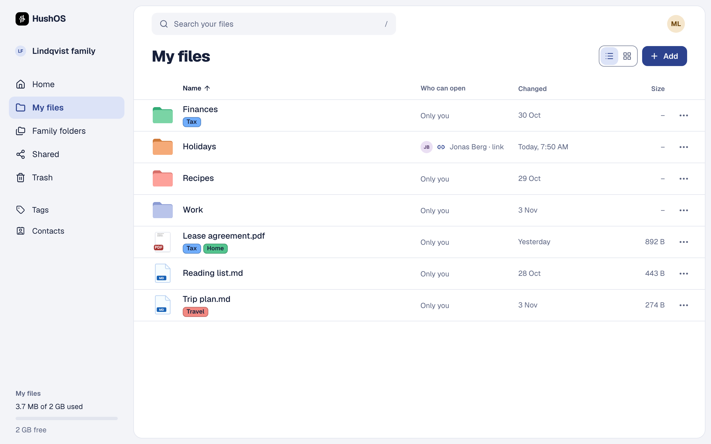
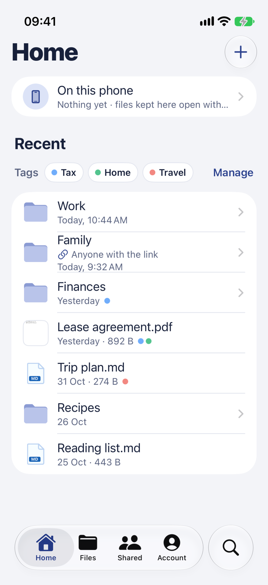
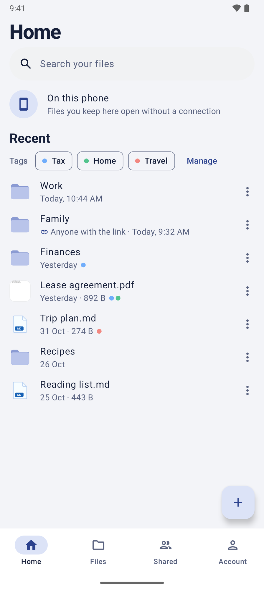

<p align="center">
    <a href="https://hushos.com"></a>
</p>

<h3 align="center">Nobody else can look inside.</h3>

<p align="center">
    An open-source drive where everything is locked on your device before it leaves.<br>
    Run it at <a href="https://hushos.com">hushos.com</a>, or on a server you control.
</p>

<p align="center">
    <a href="https://hushos.com/security">How it protects your files</a> ·
    <a href="docs/self-hosting.md">Host it yourself</a> ·
    <a href="https://hushos.com/blog">Notes from the build</a> ·
    <a href="LICENSE">AGPL-3.0</a>
</p>

<p align="center">
    <a href="https://apps.apple.com/app/hushos-encrypted-cloud-drive/id6831238356"></a>
    &nbsp;
    <a href="https://play.google.com/store/apps/details?id=com.hushos.app"></a>
</p>

<p align="center">
    <picture>
        <source media="(prefers-color-scheme: dark)" srcset="apps/web/src/screenshots/drive-wide-dark.png">
        
    </picture>
</p>

<p align="center">
    <picture>
        <source media="(prefers-color-scheme: dark)" srcset="apps/web/src/screenshots/ios-home-dark.png">
        
    </picture>
    &nbsp;&nbsp;
    <picture>
        <source media="(prefers-color-scheme: dark)" srcset="apps/web/src/screenshots/android-home-dark.png">
        
    </picture>
</p>

---

Private storage for your files, personal or work, that is simple to use.

- Files are encrypted on your device before they leave it.
- The server holds only ciphertext and the shape of the folder tree.
- It runs at [hushos.com](https://hushos.com), or on a server you control.

HushOS is an open-source, end-to-end encrypted productivity suite. Version 1 is Drive, with family plans.

## What it does

- **Accounts.** The password never leaves your device (OPAQUE). A 24-word recovery phrase gets you back in. Sign up on the web or in the phone apps.
- **Drive.** Encrypted folders and files, resumable uploads, previews (images, PDF, video, audio, Markdown, code, Office files), versions, trash, folder colours and tags. Search runs on your device.
- **Sharing.** Share with people you've checked, as viewer or editor, or by a link with an optional password and expiry. Stopping a share changes the keys.
- **Families.** Up to 20 people share one plan's storage and the family's folders. Everyone's own files stay private to them.
- **Phone apps.** iPhone (SwiftUI) and Android (Jetpack Compose) on one Rust core that does all the cryptography. Offline files, the system Files app, the share menu, and Scan document.
- **Self-hosting.** One Docker Compose file runs the whole stack, with billing off by default.

[How it protects your files](https://hushos.com/security) explains the design in plain words. The detail is in [`docs/drive-design.md`](docs/drive-design.md) and the code.

## Get it

| Where       | How                                                                                                                                                                         |
| ----------- | --------------------------------------------------------------------------------------------------------------------------------------------------------------------------- |
| Web         | [hushos.com](https://hushos.com)                                                                                                                                            |
| iPhone      | [App Store](https://apps.apple.com/app/hushos-encrypted-cloud-drive/id6831238356), or the unsigned IPA on [Releases](https://github.com/HushOS/HushOS/releases) to sideload |
| Android     | [Google Play](https://play.google.com/store/apps/details?id=com.hushos.app), or the APK on [Releases](https://github.com/HushOS/HushOS/releases)                            |
| Your server | [Self-host](#self-host) below                                                                                                                                               |

## Self-host

```sh
git clone https://github.com/HushOS/HushOS
cd HushOS
cp .env.production.example .env
docker compose up -d --build
```

- It runs the whole stack on [http://localhost:5173](http://localhost:5173), with Garage for file storage.
- Verification emails go to the log: `docker compose logs web` shows each link.
- Before other people use it, set real passwords, your public origin and a mail service in `.env`.

[docs/self-hosting.md](docs/self-hosting.md) covers every setting, the published images, backups and the object store.

## Develop

You need Bun 1.4.4 and Docker with Compose 2.24.4 or newer.

```sh
bun install --frozen-lockfile
bun run setup      # writes .env
bun run infra:up   # Postgres, Mailpit and Garage in Docker
bun run db:migrate
bun run dev        # http://localhost:5173/app
```

[CONTRIBUTING.md](CONTRIBUTING.md) has the commands, tests, conventions and how the packages fit together. The look is specified in [DESIGN.md](DESIGN.md).

## Stack

- **Web:** TanStack Start on Vite and Nitro, React Query, Tailwind v4, shadcn/ui on Base UI, Geist.
- **API:** Elysia, mounted at `/api`, with typed Eden Treaty clients.
- **Data:** PostgreSQL 18 with Drizzle, an S3-compatible store, and a pg-boss worker.
- **Phones:** SwiftUI and Jetpack Compose on a shared Rust core.
- **Tooling:** Bun workspaces, Turborepo, Oxlint and Oxfmt.

```text
apps/
    web/          The site, the app and the API
    ios/          iPhone app, with its Files, share and widget extensions
    android/      Android app
crates/
    hushos-core/  The client side of the protocol in Rust, shared by both phone apps
packages/
    auth/         Accounts and sessions
    billing/      Plans, checkout and webhooks (Polar)
    crypto/       Protocol versions, OPAQUE and key envelopes
    drive/        The tree, uploads, downloads, sharing and links
    groups/       Families: membership, signed member lists, key changes
    jobs/         The background worker
    db/           Schema, migrations and repositories
    emails/       Email templates and delivery
    tokens/       Design tokens for web, iOS and Android
    …             config, env, logging and shared helpers
```

## Security

Found a vulnerability? Please email [security@hushos.com](mailto:security@hushos.com) rather than opening an issue.

## License

[AGPL-3.0-only](LICENSE).
